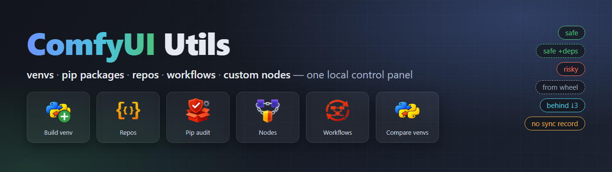
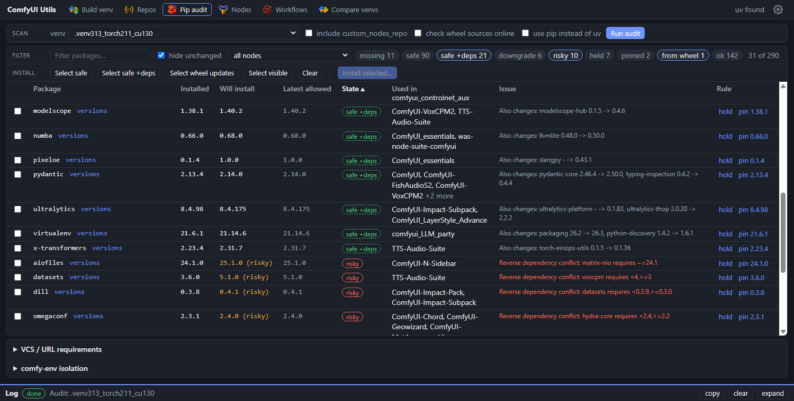
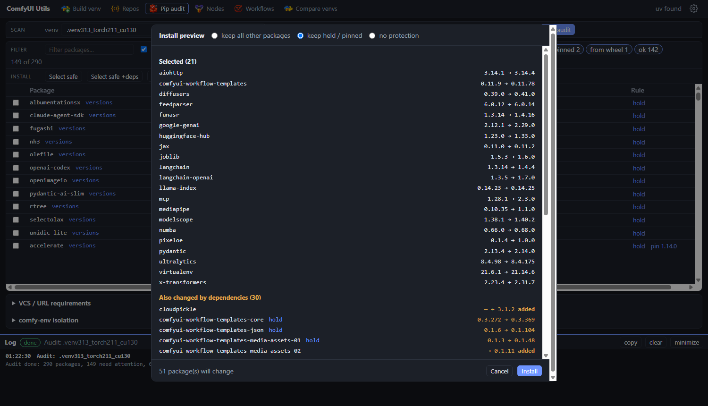

[](README.md) [](README_RU.md)

<p align="center"></p>

# ComfyUI Utils

A local toolbox for looking after a ComfyUI install: venvs, pip packages, repositories, workflows and custom-node links,
all in one browser UI. The original console tools still work (see the collapsed section at the bottom).

## Quick start

1. Start the GUI: `utils_gui_run.bat` (Linux: `utils_gui_run.sh`) or the **Utils GUI** shortcut. It opens `http://127.0.0.1:8765/`
   (`python utils_gui.py --port N --no-browser` to change that). The server listens on `127.0.0.1` only and uses the Python standard library.
2. Click the **gear** in the header and set your folders (ComfyUI, `custom_nodes`, the junction repo, workflows, wheels) and venvs. No hand editing of JSON needed.
3. Work through the tabs from left to right.

Needs: Python with `requests` and `packaging` (any ComfyUI venv has them) and [`uv`](https://docs.astral.sh/uv/) (`pip install uv`) for installs and venv building.

## Screenshots

<p align="center"><br>*Pip audit: what can be updated safely, what pulls other packages in (`safe +deps`), and what would break a requirement (`risky`), with the reason.*</p>

<p align="center"><br>*Install preview: every package an update would change, including dependencies, with a choice of what to keep untouched.*</p>

## Tabs (in the order you work)

| Tab | What it is for |
|---|---|
|  **Build venv** | Plan and build a fresh venv: picks the Python / CUDA / torch combination for which all your node requirements resolve and the most prebuilt wheels exist, then installs it with `uv`. |
|  **Custom nodes** | Two views over the same nodes. **Git:** scan ComfyUI and all custom nodes (fetch, ahead / behind, local changes), read the incoming commits, update with a policy for local changes, add a node by URL (a Pip audit starts right after), unlink or delete; filter by tag. **Links:** junction links between your node repo and `custom_nodes`, presets, tags, select by tag. The selection carries over between the views. |
|  **Pip audit** | Compare installed packages with the requirements of all nodes. States safe / safe +deps / risky, install preview with dependency changes, versions list, hold / pin, wheel updates. Install any package by hand (name or version specifier). **Check deps** runs `pip check` and adds the broken requirements to the table (tagged update / downgrade / install); **Purge cache** empties the package cache and reports the freed space. A hold or pin can be lifted for a single install when it blocks a dependency. |
|  **Workflows** | The same scan / update / add / delete for workflow sources, including partial (folder-only) sources. |
|  **Compare venvs** | Package versions side by side with colors; favorites (the key modules) are editable with undo. |

Common to all tabs: a log panel at the bottom (resizable, clearable, colored), long jobs can be cancelled, confirmations before anything destructive. A running job shows its progress on its own tab (a bar and `done/total`); a job that finishes while you are on another tab leaves a green dot there.

## Updates

What changed in the toolbox and why:

- **One GUI for everything.** Tables, filters, previews and a live log instead of console prompts. Console scripts are unchanged and keep working.
- **Pip audit judges side effects.** "safe" now means only that package changes; "safe +deps" lists the dependency changes; anything that would break a requirement, downgrade something, or touch torch / numpy is "risky". Why: one innocent update used to move numpy and a dozen packages silently.
- **Install preview + protection.** A dry run shows every package that would change, with a choice to keep held / pinned or all other packages. Every real install saves a `_before.txt` snapshot and a log in `install_logs/` for rollback.
- **No more `--upgrade`.** With uv it upgrades every dependency too. Updates now install exact versions only.
- **Versions list per package.** Every PyPI release with a verdict from the requirements files and from installed dependents; pick or install any version (answers "is there something newer that still fits?").
- **Wheel-installed packages are recognised** (sageattention, flash-attn, llama-cpp...). They are compared against `wheel_sources.json` instead of PyPI, and newer matching wheels can be downloaded and installed from the GUI.
- **Build venv.** `build_venv.py` (also a console tool): resolves all node requirements with uv, loosens conflicting pins, carries over packages from your other venvs, installs matching wheels, saves a lock in `locks/`.
- **Custom nodes / Workflows.** Fetch and ahead / behind at a glance, incoming commits before updating, local changes stashed / skipped / discarded by choice. Partial workflow sources now remember the synced commit, so they show up-to-date or behind, with a link to the original. Add and remove sources from the UI; delete refuses to lose local work unless you confirm.
- **Links view.** Junctions, presets and tags (the old link manager) with GitHub links per node, now a view of the Custom nodes tab.
- **Settings gear.** All folders, venvs (comment, CUDA path, environment variables), global environment variables, wheel sources and updater options in one dialog.
- **Shared core.** `envtools.py`, `pip_audit_core.py`, `wheels.py` hold the logic used by both the console tools and the GUI. New console flags: `comfyui_pip_update_audit.py --hide-unchanged`, `--pip`. `run_comfyui.bat` now updates the frontend packages with uv when it is on PATH.

## Shortcuts and launchers

- Windows: `*.bat` files; `powershell -ExecutionPolicy Bypass -File create_windows_links.ps1` creates `.lnk` shortcuts (with the repo icons) in `run_windows`.
- Linux: `*.sh` equivalents; `bash create_linux_links.sh` creates `.desktop` files in `run_linux`.

## Files it keeps

| File / folder | Content |
|---|---|
| `config.json` | folders, venvs (with hold / pin rules), environment variables, node tags. Edit it in **Settings**. |
| `wheel_sources.json` | wheel folder, package names and the GitHub / Hugging Face sources. |
| `update_comfy_repos_config.json` | updater options (parallel jobs, auto-merge patterns). |
| `run_comfyui_presets_config.json` | node presets (managed in the Custom nodes tab, Links view). |
| `compare_venv_versions_config.json` | favorite modules for Compare venvs (a `.bak` of the previous state is kept). |
| `install_logs/` | install / build logs, `_before.txt` snapshots, constraints used. |
| `locks/` | package lists of venvs built by `build_venv.py`. |

<details>
<summary><b>Console tools (older, still supported)</b></summary>

The original scripts and their `.bat` / `.sh` launchers are unchanged. Most of them now have a GUI tab; the sections below stay useful for scripting,
headless use, or when you prefer the terminal. Parts of the config template below are the legacy flat format; the current format is written by Settings.

### Console tools

-  `update_comfy_repos.py` updates the main ComfyUI repo and every repo in `custom_nodes` (skips
  disabled folders), and writes a detailed change log with commit messages and file diffs.
-  `update_workflow_repos.py` updates workflow sources under `user/default/workflows/github`:
  full Git repositories and partial sync folders with `.workflow_source.json`.
-  `comfyui_pip_update_audit.py` scans `requirements.txt` in the ComfyUI root and top-level
  custom nodes, compares installed vs latest versions, and prints update commands.
-  `run_comfyui.bat` launches ComfyUI with venv selection and custom-nodes presets via junctions.
-  `custom_nodes_link_manager.py` manages custom nodes junction links (compare repo vs custom_nodes, add/remove).
-  `partial_repo_sync.py` syncs selected files/folders from a git repo into a target folder
  outside the main workflow-source flow.
- `requirements_checker/` provides a richer requirements audit with config-driven environment
  selection (venv/conda), custom paths, and per-package status reporting.
-  `clone-workflow_repos.py` adds workflow sources from console-entered URLs:
  full repositories are cloned, folder URLs are synced as partial sources.
- `rename_to_english.py` renames files and folders with non-ASCII names into English equivalents (translate/transliterate) — handy for making sense of a batch of workflows with CJK names.
- `make_tmp_custom_nodes.py` generates `tmp_custom_nodes.json` with loaded/disabled nodes and
  their repo URLs, useful for collecting all plugins into a single list/repository.
-  `png_to_json.py` scans a folder of images and video (`.png/.jpeg/.webp/.bmp/.tif/.mp4/.mkv/.webm/.mov/.gif`), reads ComfyUI `workflow` metadata,
  and writes a matching `.json` file next to each file that contains a workflow.
- `comfyui_root.py` resolves the ComfyUI root using config, validation, and upward search.

### Path handling

- Scripts not assume a fixed folder layout.
- `comfyui_root.py` validates a root by checking `custom_nodes`, `models`, `main.py`,
  and `extra_model_paths.yaml.example`.
- If `Comfyui_root` is missing or invalid, the scripts search upward and save it to `config.json`.

### config.json template

Example with comments (JSONC). Remove comments in a real `config.json`.

```jsonc
{
  // ComfyUI root (auto-detected, but can be pinned)
  "Comfyui_root": "C:/ComfyUI/ComfyUI",
  // Alternative keys for the same value
  "comfyui_root": "C:/ComfyUI/ComfyUI",
  "COMFYUI_ROOT": "C:/ComfyUI/ComfyUI",

  // Single custom_nodes path (legacy, still supported)
  "custom_nodes_path": "C:/ComfyUI/ComfyUI/custom_nodes",
  // Multiple custom_nodes paths (new). Duplicates/junctions are de-duped.
  "custom_nodes_paths": [
    "D:/ComfyUI/custom_nodes",
    "E:/ComfyUI_nodes"
  ],

  // Environment type: "venv" or "conda"
  "env_type": "venv",

  // Venv: active path + known paths
  "venv_path": "C:/ComfyUI/venv",
  "venv_paths": [
    "C:/ComfyUI/venv",
    "D:/ComfyUI_envs/venv"
  ],

  // Conda: conda.exe path and environment name/folder
  "conda_path": "C:/Users/USER/miniconda3/Scripts/conda.exe",
  "conda_env": "comfyui",
  "conda_env_folder": "C:/Users/USER/miniconda3/envs/comfyui",

  // Optional project path (used by requirements_checker)
  "project_path": "C:/ComfyUI",

  // Path to custom nodes repository folder for run_comfyui.bat
  "custom_nodes_repo_path": "D:/ComfyUI/custom_nodes_repo",

  // Hold/Pin per environment (env_key = venv_path | conda_env_folder | conda_env | "default")
  "holds": {
    "C:/ComfyUI/venv": {
      "hold_packages": ["torch", "torchvision"],
      "pin_packages": {
        "numpy": "1.26.4"
      }
    },
    "conda:comfyui": {
      "hold_packages": ["xformers"],
      "pin_packages": {}
    }
  },

  // Legacy: no per-env scoping (still supported, but prefer "holds")
  "hold_packages": ["pkg1", "pkg2"],
  "pin_packages": {
    "pkg3": "1.2.3"
  }
}
```

### Custom nodes manager (custom_nodes_link_manager.py)

#### Concept: moving nodes

Core idea: keep all real nodes in a single `custom_nodes_repo` folder, while
`custom_nodes` contains only junction links. This gives one source of truth,
easier maintenance, and fast enable/disable of node sets without moving files.

#### Utility

- Shows a compact two-column list of repo nodes; linked items are marked with `=>`.
- Numbering runs top-to-bottom per column (first column, then second).
- Commands: `a` add (all), `r` remove (all), `i` invert (all), `s` sync, `p` choose preset, `w` save preset, `q` quit.
- Use `a <n>`, `r <n>`, `i <n>` to target specific indices.
- List filters: `?+` linked only, `?-` unlinked only, `?*` all.
- With a filter active, `a <n>`, `r <n>`, `i <n>` use indices from the current filtered list.
- Index selection supports single numbers, ranges, and lists (`3`, `2-6`, `1,4,9`, `1 3-5`).
- Sync adds missing links and removes extra junctions.
- `custom_nodes_repo_path` comes from `config.json` or is requested.
- `custom_nodes_path`/`custom_nodes_paths` defines the target `custom_nodes`.
- Presets are read/saved in `run_comfyui_presets_config.json`. When saving, mode (`blacklist`/`whitelist`) is chosen by the smaller disabled/enabled count.

### Partial repo sync (partial_repo_sync.py)

- For workflows, prefer `clone-workflow_repos.py` and `update_workflow_repos.py`.
- Old workflow jobs from `partial_repo_sync_config.json` are migrated to `.workflow_source.json` when `update_workflow_repos.py` runs.
- Syncs only selected files/directories from a git repo (not the full repo).
- Uses a local cache and git sparse-checkout, then copies selected paths into `target`.
- Jobs: `partial_repo_sync_config.json` (repo, branch, target, paths).
- `paths` can use regex patterns: `re:^styles/.*\\.json$` or `regex:^styles/` (git paths use `/`).
- Launcher: `partial_repo_sync_run.bat`.

### ComfyUI launcher (run_comfyui.bat)

- Reads ComfyUI root from `config.json` (`Comfyui_root`/`comfyui_root`/`COMFYUI_ROOT`) or searches upward.
- Lists `.venv*` folders and launches the selected `python.exe`.
- Applies custom nodes presets by creating junctions into `custom_nodes` from `custom_nodes_repo`.
- Cleans only junction folders; real directories are left intact.
- Presets are defined in `run_comfyui_presets_config.json` (`whitelist`/`blacklist` + `nodes` list).
- The `current` preset is a no-op.
- Creates a default `run_comfyui_presets_config.json` on first run if missing.
- Launch flags are defined in `run_comfyui_flags_config.json` as a list of objects (`name`, `keys`, `comment`).
- `current` is a list of active preset names. Press Enter to use it or enter numbers separated by spaces.
- Use `@no_update` in a preset to skip frontend package updates for that run.
- Updates ComfyUI frontend packages before launch.

### comfyui_pip_update_audit.py highlights

- Scans `requirements.txt` only (root and top-level custom nodes).
- Merges duplicate constraints and reports max allowed versions.
- Filters out pre-release and dev releases from suggested upgrades.
- Classifies updates as safe/risky/unknown and prints reasons for risky items.
- Checks reverse dependencies of already installed packages to flag conflicts before install.
- Treats inline comments in `requirements.txt` correctly (e.g. `pkg  # comment`).
- Uses `uv pip install --dry-run` for checks and prints `uv pip install --python ...` commands when `uv` is on PATH (`--pip` forces pip); the header lists pip and uv equivalents. `--hide-unchanged` skips packages that need no action. The analysis lives in `pip_audit_core.py` (`run_audit()` returns data, no printing), the script only prompts and prints.

### Hold / pin usage (comfyui_pip_update_audit.py)

- Hold: exclude packages from updates for the current env.
- Pin: lock packages to a specific version for the current env.
- Risky: dependency conflicts detected by reverse-check or `pip --dry-run`.
- Unknown: network/timeout/other non-dependency errors during dry-run.

Commands:

```bash
python comfyui_pip_update_audit.py --hold pkg1 pkg2
python comfyui_pip_update_audit.py --unhold pkg1 pkg2
python comfyui_pip_update_audit.py --pin pkg1==1.2.3 pkg2
python comfyui_pip_update_audit.py --unpin pkg1 pkg2
```

</details>

---

> [!WARNING]
> I currently work on Windows and venv environments. This combo is what gets tested.
> PS. I write these utilities for myself, try to update without breaking functionality, and add features as ideas appear.
